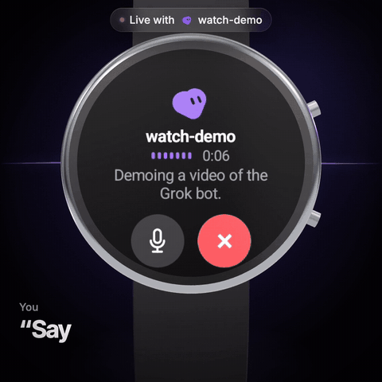
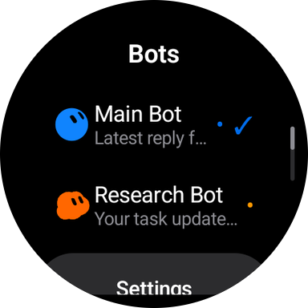
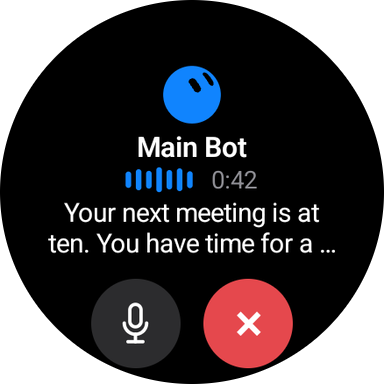
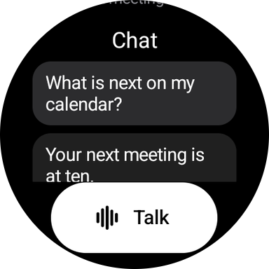

# Grok Wear

Talk to any of your Grok Bots from your Wear OS watch. Hands-free, real-time voice, synced to your Bot's chat.

<p align="center"></p>

> **Unofficial project.** Grok Wear is independent and is not affiliated with, endorsed by or sponsored by xAI or Cursor. Grok and Grok Bot are trademarks of xAI. See [NOTICE.md](NOTICE.md).

## [⬇ Download the APK](https://github.com/maplenk/grok-wear/releases/latest)

**[Install guide](docs/INSTALL.md)** · about ten minutes, once, from a computer on the same Wi-Fi.

**Works on:** Wear OS 3+ (API 30+). Tested on Galaxy Watch and the Wear OS emulator.

## What it does

<p align="center">
  
  
  
</p>

- **Sign in on your phone.** The watch shows a QR code; you approve the sign-in in your phone's browser. Nothing is typed on the watch.
- **Pick any Bot.** Your Primary Bot sits at the top of Home, with the rest of your roster below.
- **Talk.** One tap starts a hands-free voice conversation. The Bot hears you through the watch microphone and answers through the watch speaker, with captions that follow along. Speak over it to interrupt.
- **Shared conversation.** Each Bot's page shows its recent chat. A voice call starts from that context, and its transcript is saved back to the Bot's history, so the conversation continues on your phone or desktop.
- **Read-only by design.** The Bot can look things up during a call, but actions that change things (sending tasks, approvals) are refused on the watch.

## Status and limits

This is an experimental client. It talks to Grok Bot's **private, undocumented client API**, reconstructed from the official apps. That API can change or break without notice, and using it may not be permitted by xAI's terms. Use it at your own risk, with an account you are responsible for.

- Calls end after five minutes. A dropped connection ends the call; there is no automatic reconnect.
- The watch needs its own internet connection (Wi-Fi or LTE).

## Build from source

Requirements: JDK 17 and the Android SDK (platform 36). The Gradle wrapper pins its own version.

```sh
./gradlew :app:testDebugUnitTest :app:assembleRelease
```

The APK is written to `app/build/outputs/apk/release/app-release.apk`. Without a signing configuration it is signed with your local debug key, which is fine for your own watch. To sign with your own key, create `keystore.properties` in the project root (it is git-ignored):

```properties
storeFile=/path/to/your-release.jks
storePassword=...
keyAlias=...
keyPassword=...
```

Debug builds include an offline UI preview of every screen, with no account, microphone or network:

```sh
adb shell am start -n si.zya.grokwear/.MainActivity --ez ui_preview true --es preview_screen ready
```

## Privacy and security

- Your sign-in stays on the watch, encrypted with a key held in the Android Keystore. It is sent only to Grok Bot's own servers.
- Audio streams directly between the watch and xAI's realtime voice service. No other server is involved, and no audio is stored.
- The final text of each call is saved to your Bot's history in your Grok account, as the official apps do.
- No analytics, ads or tracking. Screenshots of account screens are blocked.

Details: [PRIVACY.md](PRIVACY.md). To report a vulnerability, see [SECURITY.md](SECURITY.md).

## How it works

[docs/ARCHITECTURE.md](docs/ARCHITECTURE.md) describes the sign-in, history, voice and audio pipeline, and the limits the app enforces.

## FAQ

**Does it work on iPhone or Apple Watch?**
Not this app; Grok Wear is for Wear OS only. A separate community app exists for Apple Watch.

**Is it official?**
No. Grok Wear is independent and is not affiliated with, endorsed by or sponsored by xAI or Cursor.

**Will it break?**
It uses a private, undocumented API, so it can. If Grok Bot changes that API, Grok Wear may stop working until it is updated.

**Is it on the Play Store?**
Planned, not yet. For now, install it from the [latest release](https://github.com/maplenk/grok-wear/releases/latest) using the [install guide](docs/INSTALL.md).

## Contributing

Bug reports, device reports and pull requests are welcome. See [CONTRIBUTING.md](CONTRIBUTING.md).

## License

The source code is released under the [MIT License](LICENSE). The Bot avatar design data in `app/src/main/assets/bot-avatar.json` belongs to xAI and is **not** covered by that license; see [NOTICE.md](NOTICE.md).
