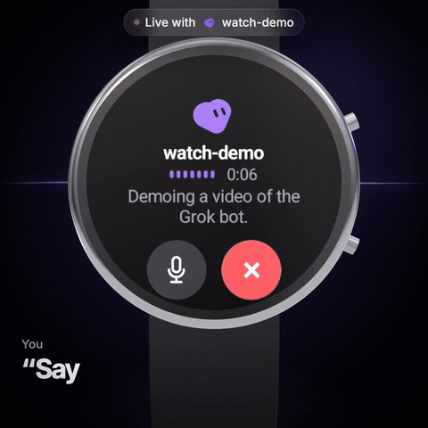
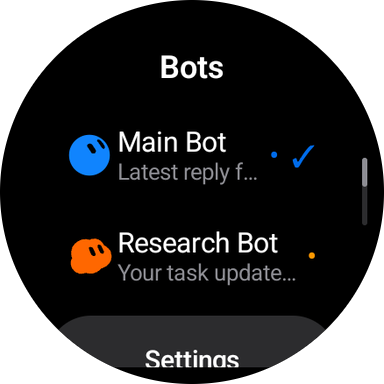
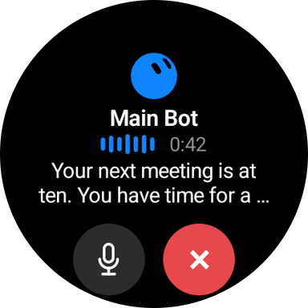
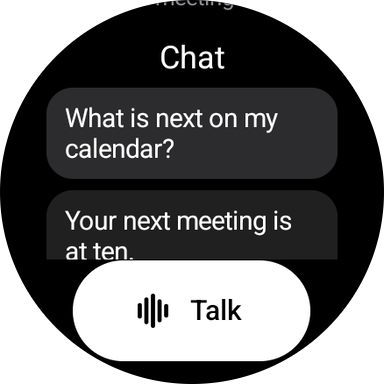

# Grok Wear

Talk to any of your Grok Bots from your Wear OS watch. Hands-free, real-time voice, synced to your Bot's chat.

<p align="center"></p>

> **Unofficial project.** Grok Wear is independent and is not affiliated with, endorsed by or sponsored by xAI or Cursor. Grok and Grok Bot are trademarks of xAI. See [NOTICE.md](NOTICE.md).

## [⬇ Download the APK](https://github.com/maplenk/grok-wear/releases/latest)

**[Install guide](docs/INSTALL.md)** · about ten minutes, once, from a computer on the same Wi-Fi.

**Works on:** Wear OS 3+ (API 30+). Tested on Galaxy Watch, Pixel Watch and the Wear OS emulator.

## What it does

<p align="center">
  
  
  
</p>

- **Sign in on your phone.** The watch shows a QR code; you approve the sign-in in your phone's browser. Nothing is typed on the watch. If Grok refuses the sign-in (the account, or your organisation's sign-in policy), the watch says so, with Sign in again and Try again.
- **Pick any Bot.** Your Primary Bot sits at the top of Home, then your pinned Bots as big tiles, then the rest of your roster.
- **Pinned Bots.** Hold a Bot to pin or unpin it, or use Pin on its page. Pins are your account's own list, shared with the official apps on your phone and desktop.
- **Talk.** One tap starts a hands-free voice conversation. The Bot hears you through the watch microphone and answers through the watch speaker, with captions that follow along. Speak over it to interrupt. The Bot's voice follows the watch's media volume (call volume with a headset).
- **Shared conversation.** Each Bot's page shows its recent chat. During a call the Bot can look up your chats, as in the official apps, and the call's transcript is saved back to the Bot's history.
- **The Bot's own voice.** Calls use the voice, speed and language you chose for each Bot in the official apps.
- **Follow-up in chat.** When you hang up, the Bot gets the same end-of-call note the official apps send, plus anything you asked for on the call. It can then finish the job in its chat on your phone or desktop.
- **Tasks during calls.** Like the official apps, the Bot can look things up and hand tasks to its main agent while you talk ("check my inbox"); results follow in its chat. Work that finishes while you're still on the call reaches the call, and the Bot tells you then, as in the official apps.
- **Text messages.** Tap Message on a Bot's page, then dictate, type or draw. You review the text before it goes, and the chat shows Sending…, then Sent, then the Bot's reply. If the connection drops mid-send, the watch asks Grok whether the message arrived, as the phone app does, and shows Sent or Not sent. A message Grok never got is never sent again on its own: tap it to send it again. Prefer the newest message at the top? Turn on Newest first in Settings.
- **Live updates.** While the app is open, new messages, unread counts and "Working…" appear as they happen, from the same live feed the official apps use. As in the official apps, a Bot with unread follow-up threads counts as unread.
- **Needs you.** When a Bot is waiting for your answer, such as a question or a request for your OK, Home shows an orange "Needs you" under its name, or an orange dot on its pinned tile.
- **Bots that run on Grok's servers.** Since Grok Bot 1.25 some Bots run on Grok's own servers rather than a sandbox. The watch reads, messages and calls them the way the phone app does: messages go straight to Grok, their unread counts, previews and "Working…" come from Grok's own live feed, and calls are saved to their history.
- **Quick questions.** When a Bot asks you something with ready answers ("Allow" or "Don't allow"), its chat shows them as buttons: one tap answers, or pick several and tap Done when more than one applies, and ✕ dismisses the question. Your answer shows at once and, if Grok turns it down, the buttons come back. A waiting reply alert buzzes with the question. When the Bot then needs your phone itself (to read your phone's calendar, say), the chat says to answer on your phone.
- **Requests for your OK.** When a Bot asks for your OK, its chat shows the request with Allow and Deny, and a waiting reply alert shows it too. "Always allow" sets a standing rule, so it stays on your phone.
- **Bot phone calls.** When a Bot places a phone call for you, its chat shows the call as it happens, with End call and, when Grok offers it, Take over. If the person on the call asks something only you can answer, the chat shows the question with a countdown: Send dictates, types or draws your answer (with the Bot's suggestion one tap away), or Skip. If a reply alert is waiting for that Bot, the watch buzzes with the question.
- **Out of usage.** When Grok says you've run out of usage, the chat and reply alerts say so, with when it resets, instead of waiting for a reply that won't come. A notice Grok gave while the watch was offline shows up once it reconnects.
- **Reply alerts.** After sending a message you can leave the app: the watch buzzes when the Bot replies, and tapping the alert opens that chat. If you read that chat on your phone first, the alert goes away on its own, as the phone's notifications do, whenever the watch is listening for updates (app open, or waiting for another reply). You choose whether to turn them on right after signing in, and can switch them on or off any time in Settings.
- **Assistant button.** Hold the watch's assistant button (on a Galaxy Watch, the Home key; on a Pixel Watch, the crown) to call your main Bot, as the official app's assistant does on phones. It costs no battery and keeps no microphone open. You're offered it right after signing in, and it's in Settings; turning it on makes Grok Wear the watch's digital assistant in place of the current one.
- **Report a problem.** A stuck Bot list, a call that stopped or dropped, and a sign-in problem each have a Report a problem button, also in Settings. It shows a QR code. Scan it with your phone to write an email to the developer, or open a new GitHub issue, with your watch model, the app version, the latest error and where in the app it happened, and a short log of recent Bot list loads and calls filled in. (Mail apps on Wear OS don't accept a drafted email from other apps, so it's sent from the phone.) **Send logs**, off by default and off again each time, uploads the full recent log to the developer's Sentry project when you turn it on and tap Send, and adds a Log ID to your message. Never chats, Bot names or account details. See [PRIVACY.md](PRIVACY.md).
- **When Grok refuses your account,** the watch asks why, as the official apps do: a team that no longer applies is dropped, a rejected sign-in is renewed once, and otherwise Needs attention says what's wrong (a plan or free trial needed, a team admin to ask, privacy mode, setup to finish) with a QR code to Grok's page for it, and Sign in again. If Grok says the app's version is too old, the watch asks Grok's update server for the current one and carries on, so a Grok update doesn't need a new Grok Wear.
- **When the Bot list is slow or stuck,** it shows how long it has been loading and over which network, and a failure says why. Details shows the recent attempts, with Report a problem one tap away. Nothing is sent from the watch.

## Status and limits

This is an experimental client. It talks to Grok Bot's **private, undocumented client API**, reconstructed from the official apps. That API can change or break without notice, and using it may not be permitted by xAI's terms. Use it at your own risk, with an account you are responsible for.

- Calls end after five minutes. A dropped connection is redialled automatically for up to about two minutes.
- The watch needs its own internet connection (Wi-Fi or LTE).
- While Grok Wear is the watch's assistant, "Hey Google" and the watch's own assistant don't answer; choose another assistant in watch settings to switch back.
- Reply alerts cover messages sent from the watch, for up to ten minutes after sending. Grok Bot's own push notifications go to its phone app only; Wear OS can mirror those to the watch, but tapping them opens the phone.

## Build from source

Requirements: JDK 17 and the Android SDK (platform 36). The Gradle wrapper pins its own version.

```sh
./gradlew :app:testDebugUnitTest :app:assembleRelease
```

The APK is written to `app/build/outputs/apk/release/app-release.apk`. Without a signing configuration it is signed with your local debug key, which is fine for your own watch. To sign with your own key, create `keystore.properties` in the project root (it is git-ignored):

```properties
storeFile=/path/to/your-release.jks
storePassword=...
keyAlias=...
keyPassword=...
```

Debug builds include an offline UI preview of every screen, with no account, microphone or network:

```sh
adb shell am start -n si.zya.grokwear/.MainActivity --ez ui_preview true --es preview_screen ready
```

## Privacy and security

- Your sign-in stays on the watch, encrypted with a key held in the Android Keystore. It is sent only to Grok Bot's own servers.
- Audio streams directly between the watch and xAI's realtime voice service. No other server is involved, and no audio is stored.
- The final text of each call is saved to your Bot's history in your Grok account, as the official apps do.
- No analytics, ads or tracking. Screenshots of account screens are blocked.

Details: [PRIVACY.md](PRIVACY.md). To report a vulnerability, see [SECURITY.md](SECURITY.md).

## How it works

[docs/ARCHITECTURE.md](docs/ARCHITECTURE.md) describes the sign-in, history, voice and audio pipeline, and the limits the app enforces.

## FAQ

**Does it work on iPhone or Apple Watch?**
Not this app; Grok Wear is for Wear OS only. A separate community app exists for Apple Watch.

**Is it official?**
No. Grok Wear is independent and is not affiliated with, endorsed by or sponsored by xAI or Cursor.

**Will it break?**
It uses a private, undocumented API, so it can. If Grok Bot changes that API, Grok Wear may stop working until it is updated.

**Is it on the Play Store?**
Planned, not yet. For now, install it from the [latest release](https://github.com/maplenk/grok-wear/releases/latest) using the [install guide](docs/INSTALL.md).

## Contributing

Bug reports, device reports and pull requests are welcome. See [CONTRIBUTING.md](CONTRIBUTING.md).

## License

The source code is released under the [MIT License](LICENSE). The Bot avatar design data in `app/src/main/assets/bot-avatar.json` belongs to xAI and is **not** covered by that license; see [NOTICE.md](NOTICE.md).
